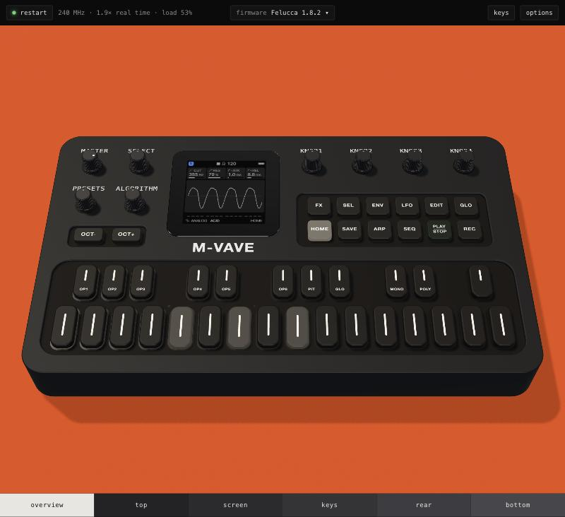

# fm1-3d

A three.js model of the M-VAVE FM-1 pocket synth that runs real firmware in the browser.

**[Try it →](https://taylorrichie.github.io/fm1-3d/)**



This is only a front end. The emulation is [fm1-emu](https://github.com/joakimeriksson/fm1-emu) by
Joakim Eriksson, which emulates the FM-1's own chip and runs firmware packages unchanged. This
project puts a 3D model of the hardware in front of that core.

## What it does

- Boots firmware from [The Firmware Hub](https://thefirmwarehub.com/) catalog, or a `.fwsc` file you open or drop on the page.
- Keys, buttons and knobs work with mouse and touch; the keys sink, the knobs turn, and the backlights follow the firmware's LED output.
- Computer keyboard mapping (the **keys** button shows it) and Web MIDI input.
- Views: overview, top, screen, keys, rear, and bottom (the synth turns over).
- **Player** view for phones: the synth fills the screen from above with the camera locked, so every touch plays it. Add `?player` to the address to open straight into it.
- Five colourways.
- Patches and settings a firmware saves are kept in the browser, per firmware.

## Run it locally

No build step and no dependencies to install:

```bash
python3 -m http.server 8650
```

Then open http://localhost:8650. Any static file server works.

## How it is put together

| Path | What it is |
|---|---|
| `src/layout.js` | Panel measurements, key ids, keyboard map and colourways |
| `src/device.js` | The 3D model |
| `src/emu.js` | Talks to the emulator's audio worklet |
| `src/main.js` | Scene, camera, input and the page's controls |
| `core/` | Built files from fm1-emu (commit `e058cf5`), unmodified |
| `vendor/three/` | three.js r187 |

`npm run sync-core` rebuilds the core from an fm1-emu checkout beside this folder.

For scripting, the page exposes `window.fm1` with `press(id)`, `release(id)`, `turn(index, clicks)`,
`setPot(value)`, `boot()`, `goTo(view)` and `setTheme(name)`.

## Known gaps

- The model is built from product photos, so proportions are close rather than measured.
- The rear connectors are drawn on, and the power switch does nothing.
- Lit controls all glow warm white (PLAY green); the real LED colours may differ.
- fm1-emu's own page does more: the SMK-37, DX7 bank loading, save export and import.

## Credits and licences

- Inspired by [OP-1 Field: Interactive Study](https://mitchivin.github.io/te-op1-field/) by mitchivin.
- This project: MIT, see `LICENSE`.
- Emulator core in `core/`: [fm1-emu](https://github.com/joakimeriksson/fm1-emu), MIT, see `core/LICENSE-fm1-emu`.
- [three.js](https://threejs.org/): MIT, see `vendor/three/LICENSE`.
- Firmwares belong to their authors and are fetched from their own hosts when you pick one. None are stored here.

Unofficial and not affiliated with M-VAVE. The maker's logo on the model can be turned off under **options**.
